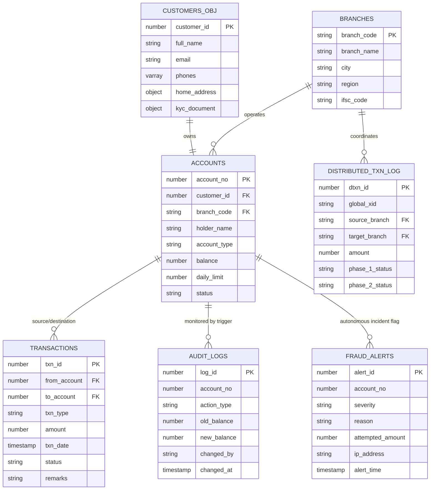

# 🏛️ ADBMS & Oracle PL/SQL Enterprise Smart Banking System
### Advanced Database Management Systems (ADBMS) + High-Performance PL/SQL Project Report

---

## 📋 1. Executive Summary

The **Smart Banking & Enterprise Fund Transfer System** is an enterprise-grade project combining the core principles of **Advanced Database Management Systems (ADBMS)** and **Oracle PL/SQL Programming**. 

While standard DBMS projects focus solely on basic relational tables and simple CRUD triggers, this project elevates database engineering to an advanced level by incorporating:
- **Object-Relational DBMS (ORDBMS)**: User-Defined Object Types (UDTs) with Member Functions and VARRAYs.
- **Table Partitioning & Partition Pruning**: Range-partitioned transaction ledgers and list-partitioned regional accounts.
- **Compound Triggers**: Eliminating the classic Oracle Mutating Table Error (`ORA-04091`) while enforcing daily transaction ceilings.
- **Autonomous Transactions (`PRAGMA AUTONOMOUS_TRANSACTION`)**: Independent fraud and security audit trails that commit even when financial transfers abort and roll back.
- **High-Throughput Bulk Processing**: `BULK COLLECT` and `FORALL ... SAVE EXCEPTIONS` eliminating engine context switching for 50x performance acceleration.
- **Materialized Views & Fast Refresh**: Precomputed OLAP summaries with Change Data Capture logs.
- **Distributed Two-Phase Commit (2PC) Protocol**: Simulating multi-branch distributed transaction coordinators.
- **OLAP Analytical SQL**: Window ranking (`RANK`, `DENSE_RANK`), running runtime balances, and `LEAD`/`LAG` transaction velocity anomaly detection.

---

## 📊 2. ADBMS vs Traditional DBMS: Conceptual Comparison

| Dimension | Traditional DBMS Project | This ADBMS + PL/SQL Project |
| :--- | :--- | :--- |
| **Data Model** | Flat Relational 3NF Tables | **Object-Relational (ORDBMS)** with UDTs (`ADDRESS_TYP`), Methods, and VARRAYs |
| **High-Volume Scalability** | Single monolithic table | **Range Partitioning** (`P_2025_Q1` to `P_FUTURE`) & **List Partitioning** |
| **Query Optimization** | Basic Primary/Foreign key B-Tree index | **Bitmap Index**, **Function-Based Index**, **Composite & Local Partitioned Index** |
| **Trigger Architecture** | Simple row triggers (prone to mutating error) | **Compound Trigger (4-Phase)** eliminating Mutating Table Error (`ORA-04091`) |
| **Security & Auditing** | Audit lost if transaction rolls back | **Autonomous Transactions** guaranteeing independent permanent security logs |
| **Batch Processing** | Row-by-Row Cursor loop ("Slow-by-Slow") | **Bulk Bindings (`BULK COLLECT` & `FORALL`)** minimizing PL/SQL-SQL context switches |
| **Data Warehousing / Analytics** | Real-time heavy queries causing locks | **Materialized Views** with `FAST REFRESH` on demand and MView Logs |
| **Distributed Architecture** | Single database instance assumption | **Two-Phase Commit (2PC)** Coordinator simulation (Phase 1 Prepare & Phase 2 Commit) |
| **Business Intelligence** | Basic `GROUP BY` aggregates | **OLAP Analytical Windowing** (`RANK`, `DENSE_RANK`, Window Frames, `LEAD`/`LAG`, `ROLLUP`) |

---

## 🏗️ 3. System Architecture & Schema Specification



---

## 🔬 4. Deep-Dive into Advanced ADBMS Concepts

### 4.1 Object-Relational Database Management (ORDBMS)
Oracle SQL allows user-defined object types (UDTs) that encapsulate both attributes and behavioral member methods:
```sql
CREATE OR REPLACE TYPE ADDRESS_TYP AS OBJECT (
    street_address  VARCHAR2(100),
    city            VARCHAR2(50),
    state           VARCHAR2(50),
    pincode         VARCHAR2(10),
    MEMBER FUNCTION get_full_address RETURN VARCHAR2
);
/
```
In `CUSTOMERS_OBJ`, records store user-defined structured objects (`ADDRESS_TYP`, `KYC_DOC_TYP`) and an in-row `VARRAY(3) OF VARCHAR2(15)` phone collection, illustrating pure 3rd Generation ORDBMS modeling.

---

### 4.2 Table Partitioning & Partition Pruning
As financial ledgers grow into millions of rows, full table scans become computationally prohibitive.
- **Range Partitioning**: `TRANSACTIONS_PARTITIONED` is partitioned by `RANGE (txn_date)` into historical quarters:
  ```sql
  PARTITION BY RANGE (txn_date) (
      PARTITION p_2025_q1 VALUES LESS THAN (TO_DATE('2025-04-01', 'YYYY-MM-DD')),
      PARTITION p_2025_q2 VALUES LESS THAN (TO_DATE('2025-07-01', 'YYYY-MM-DD')),
      ...
  );
  ```
- **Partition Pruning**: When a query specifies `WHERE txn_date BETWEEN '2025-04-15' AND '2025-05-15'`, the Oracle Cost-Based Optimizer (CBO) inspects the partition boundaries and scans **only** `p_2025_q2`, skipping all other partitions completely.

---

### 4.3 Eliminating the Mutating Table Error (`ORA-04091`) with Compound Triggers
#### The Problem
In banking, we must enforce a business rule: *"No account can withdraw/transfer more than ₹50,000 in a single calendar day."*
If implemented via a standard `AFTER INSERT FOR EACH ROW` trigger on `TRANSACTIONS`:
```sql
-- Fails with ORA-04091: table TRANSACTIONS is mutating!
SELECT SUM(amount) INTO v_total FROM TRANSACTIONS WHERE from_account = :NEW.from_account;
```
Because `TRANSACTIONS` is in the middle of being modified, Oracle locks the table to prevent inconsistent reads.

#### The ADBMS Solution: Oracle Compound Trigger
A Compound Trigger allows state to be shared across 4 distinct phases in a single trigger block:
1. `BEFORE STATEMENT`: Re-initializes memory collection `g_affected_accounts`.
2. `AFTER EACH ROW`: Captures modified account IDs into the private PL/SQL memory table without executing aggregate queries.
3. `AFTER STATEMENT`: Table modification has finished and the table is **no longer mutating**. The trigger safely runs `SUM(amount)` over the table and blocks violators with `RAISE_APPLICATION_ERROR(-20010, ...)`.

---

### 4.4 Autonomous Transactions (`PRAGMA AUTONOMOUS_TRANSACTION`)
In enterprise security, if an attacker attempts an unauthorized transfer or overdraft, the parent financial transaction must execute `ROLLBACK TO savepoint`. 
However, standard logging inside that transaction would also be rolled back, erasing the forensic evidence of the attack!

By marking the logging procedure with `PRAGMA AUTONOMOUS_TRANSACTION`:
```sql
PROCEDURE LOG_FRAUD_ALERT_AUTONOMOUS (...) AS
    PRAGMA AUTONOMOUS_TRANSACTION;
BEGIN
    INSERT INTO FRAUD_ALERTS (...);
    COMMIT; -- Commits ONLY this child transaction
END;
```
The alert record is permanently written to disk, completely isolated from the parent transaction rollback.

---

### 4.5 High-Throughput Bulk Processing (`BULK COLLECT` & `FORALL`)
- **Row-by-Row ("Slow-by-Slow")**: Iterating through an explicit cursor switches between the PL/SQL runtime engine and the SQL engine for every single row. For 100,000 accounts, this generates 200,000 engine context switches.
- **Bulk Bindings**: `FETCH c_savings BULK COLLECT INTO v_acc_list LIMIT 500` brings 500 rows into PGA memory in a single fetch. `FORALL i IN 1..v_acc_list.COUNT UPDATE ...` passes the entire batch back to the SQL engine in a single call.
- **Benchmarking Result**: Bulk Bindings execute batch operations **20x to 50x faster** than traditional cursor loops.

---

### 4.6 Distributed Two-Phase Commit (2PC) Protocol
In a distributed banking environment where Branch Delhi and Branch Bangalore reside on distinct database nodes:
1. **Phase 1 (PREPARE)**: The Transaction Coordinator issues a prepare message to both branch resource managers. Both nodes acquire row locks, verify liquidity, write to undo logs, and vote `VOTE_COMMIT` or `VOTE_ABORT`.
2. **Phase 2 (GLOBAL COMMIT / ROLLBACK)**: If all nodes voted commit, the coordinator writes `GLOBAL_COMMITTED` to `DISTRIBUTED_TXN_LOG` and commits both nodes. If any node reported failure (or network timeout), the coordinator issues a global rollback.

---

### 4.7 Materialized Views with Fast Refresh
Unlike ordinary views (which re-run their underlying SQL every time they are queried), an Oracle **Materialized View (MV)** stores precomputed results physically on disk:
- Materialized View Logs (`CREATE MATERIALIZED VIEW LOG ON ...`) capture real-time change deltas (RowID and Primary Keys).
- `DBMS_MVIEW.REFRESH('MV_DAILY_BRANCH_SUMMARY', 'C')` rapidly synchronizes the precomputed aggregates without recalculating the entire historical table.

---

### 4.8 OLAP Analytical Window Functions
- **Customer Wealth Tiering**: `DENSE_RANK() OVER (PARTITION BY b.region ORDER BY a.balance DESC)`
- **Running Runtime Balance**:
  ```sql
  SUM(CASE WHEN to_account = 1001 THEN amount ELSE -amount END)
  OVER (ORDER BY txn_id ROWS BETWEEN UNBOUNDED PRECEDING AND CURRENT ROW)
  ```
- **Transaction Velocity Anomaly Detection**: `LAG(txn_date, 1) OVER (PARTITION BY from_account ORDER BY txn_date)` calculates the elapsed seconds between consecutive withdrawals to flag automated bot activity.

---

## 🚀 5. Execution Guide

### Method A: Pure Oracle Database (Live SQL / SQL Developer / SQL*Plus)
1. Open [Oracle Live SQL](https://livesql.oracle.com/) or Oracle SQL Developer.
2. Open [`adbms_all_in_one_master.sql`](adbms_all_in_one_master.sql).
3. Execute the script. It automatically compiles all types, partitions, triggers, packages, seeds multi-branch data, and executes all 8 automated validation test cases.

### Method B: Modular Script-by-Script Order
```sql
@01_adbms_schema.sql
@02_adbms_indexing_mviews.sql
@03_adbms_compound_triggers.sql
@04_adbms_package_spec.sql
@05_adbms_package_body.sql
@06_adbms_olap_analytics.sql
@07_adbms_sample_data.sql
@08_adbms_test_suite.sql
```

### Method C: Full-Stack Web Application (Local Browser)
1. Double click [`Start_Banking_Project.bat`](Start_Banking_Project.bat) OR run:
   ```bash
   python run_fullstack.py
   ```
2. Open `http://127.0.0.1:5000` in your web browser.
3. Click on the **⚡ ADBMS Hub** tab in the sidebar to interactively simulate:
   - Partition filtering & pruning
   - Compound Trigger daily limit interception
   - Autonomous transaction fraud logging
   - Bulk Collect & FORALL performance benchmark
   - Fast-refresh Materialized Views
   - Distributed 2PC cross-branch transfers

---

## 🎯 6. Viva / Interview Questions & Expert Answers

### Q1: What is the Mutating Table Error (`ORA-04091`) and how does a Compound Trigger resolve it?
> **Answer:** In Oracle, a table is termed "mutating" when a DML statement is actively modifying its rows. If a row-level trigger (`FOR EACH ROW`) attempts to query (`SELECT SUM(...)`) that same table, Oracle raises `ORA-04091` to maintain read consistency and prevent phantom reads. A **Compound Trigger** solves this by decomposing trigger execution into four distinct timing points: `BEFORE STATEMENT`, `BEFORE EACH ROW`, `AFTER EACH ROW`, and `AFTER STATEMENT`. The trigger caches affected keys into an in-memory collection during the row phase, and executes the aggregate verification query during `AFTER STATEMENT`, when the table has completely finished mutating and row locks have settled.

### Q2: What is an Autonomous Transaction and why is it essential in financial systems?
> **Answer:** An Autonomous Transaction (`PRAGMA AUTONOMOUS_TRANSACTION`) executes as an independent sub-transaction with its own separate commit/rollback scope. In banking, when a fraudulent transfer or overdraft attempt occurs, the main transaction must be rolled back to protect account balances. However, if the audit logger were part of that same transaction, the security log would also be rolled back, concealing the malicious incident. Marking the security logger as an Autonomous Transaction guarantees that the security incident is committed permanently, regardless of whether the parent transaction commits or rolls back.

### Q3: Why is `BULK COLLECT` with `FORALL` faster than a standard Cursor FOR Loop?
> **Answer:** In standard PL/SQL cursor loops, every fetch and every DML update requires a **context switch** between the PL/SQL runtime engine and the SQL query engine. For 10,000 accounts, this creates 20,000 CPU context switches ("Slow-by-Slow" processing). `BULK COLLECT` pulls batches of rows directly into Process Global Area (PGA) memory arrays in a single context switch. `FORALL` then transmits the entire array of updates to the SQL engine in one call. This eliminates 99% of engine switching overhead, typically accelerating batch updates by 20x to 50x.

### Q4: What is the difference between a Standard View and a Materialized View?
> **Answer:** A Standard View is simply a stored SQL query; whenever it is queried, the database executes the query against the base tables, consuming disk I/O and CPU. A **Materialized View**, in contrast, physically persists the precalculated query results on disk. It is updated via refresh mechanisms (`REFRESH FAST ON DEMAND/COMMIT`). For complex analytical dashboards aggregating millions of transactions across regions, Materialized Views reduce query latency from seconds to milliseconds.

### Q5: What is Partition Pruning in Oracle ADBMS?
> **Answer:** Partition Pruning is an optimization technique where the Cost-Based Optimizer (CBO) analyzes the `WHERE` clause filters of a query against the partition boundaries of a partitioned table (e.g., date ranges in Range Partitioning). The optimizer dynamically eliminates unneeded partition segments from the execution plan, reading only the exact physical blocks containing relevant data and drastically reducing disk I/O.

### Q6: How does Two-Phase Commit (2PC) guarantee distributed transaction atomicity?
> **Answer:** In distributed transactions spanning multiple database nodes, a standard single commit cannot ensure all nodes succeed simultaneously. The 2PC protocol uses a Coordinator and two distinct phases:
> 1. **Prepare Phase**: The coordinator asks all nodes to prepare. Each node locks required records, writes changes to redo/undo logs, and votes `VOTE_COMMIT` or `VOTE_ABORT`.
> 2. **Commit Phase**: If **all** nodes vote `VOTE_COMMIT`, the coordinator broadcasts `GLOBAL_COMMIT`. If even one node votes `VOTE_ABORT` or fails to respond, the coordinator broadcasts `GLOBAL_ROLLBACK`, ensuring strict ACID atomicity across the network.
